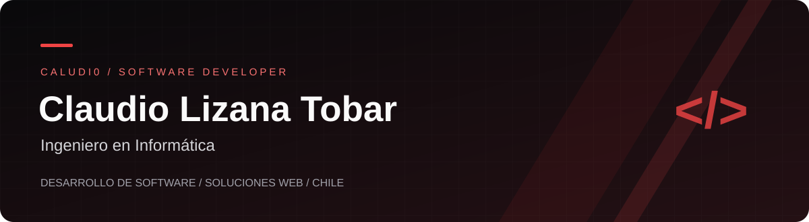

  

  
  

## Sobre mí

Soy **Claudio Lizana Tobar**, Ingeniero en Informática, desde Puerto Montt, Chile.

Me enfoco en el desarrollo de software y soluciones web para apoyar procesos de negocio. Me interesa construir herramientas útiles, mantener el código organizado y documentar las decisiones que permiten continuar un proyecto.

## En qué me enfoco

- **Desarrollo web:** soluciones para presentar negocios y apoyar sus procesos.
- **Python:** programación y automatización de tareas.
- **Organización del software:** modularización, separación de responsabilidades y documentación.

## Proyectos y aprendizaje

| Espacio | Qué encontrarás |
| :--- | :--- |
| [Prácticas Java](https://github.com/Caludi0/Practicas-Java) | Repositorio de aprendizaje de Java. |
| [Práctica HTML y CSS](https://github.com/Caludi0/Practica-HTML-CSS) | Espacio destinado a material y ejercicios de desarrollo web. |

### Experiencia y confidencialidad

Parte de mi trabajo está sujeta a acuerdos de confidencialidad. Por ese motivo, este perfil reúne únicamente material público; no incluye código, datos ni documentación interna de clientes.

## Conversemos

¿Tienes una oportunidad profesional en desarrollo de software?

Puedes conocer mis proyectos y mi trabajo en **[GitHub](https://github.com/Caludi0)**.
